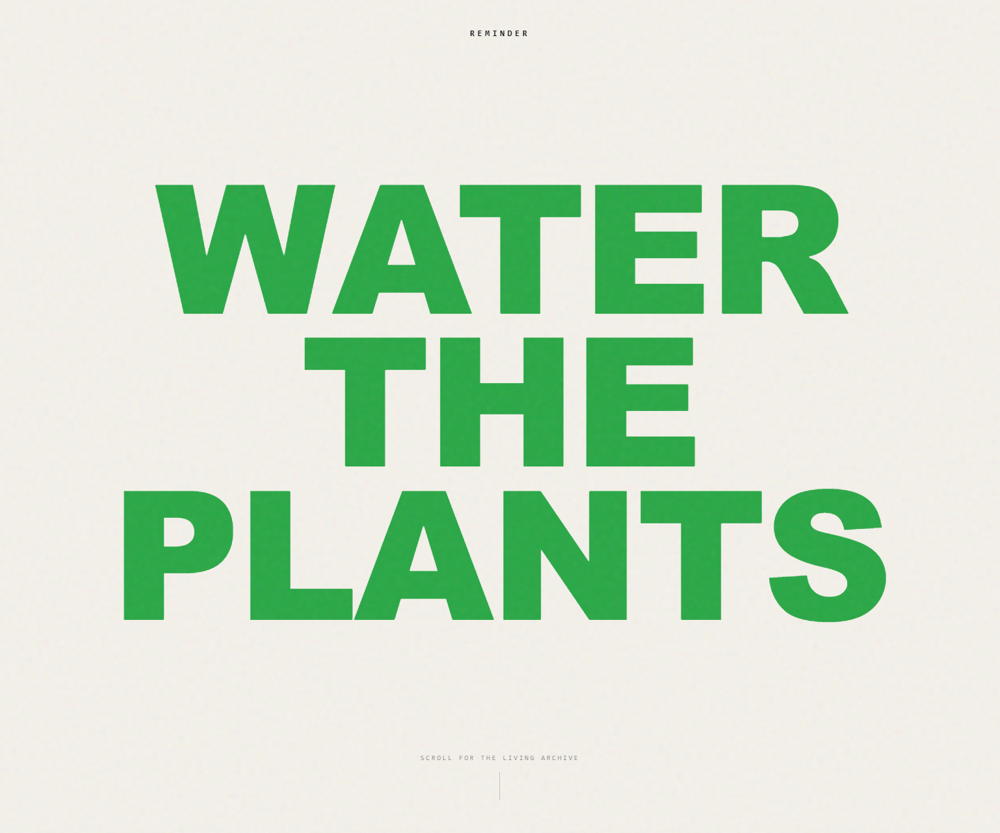

# Plantasia

Plantasia is a poster-style plant care app for keeping a living archive of houseplants, watering rituals, and plant notes. The interface opens with a huge editorial reminder, then scrolls into a Pinterest-like wall of plant posters.



## What It Does

- Shows a full-screen "Water the Plants" landing poster with scroll-driven motion.
- Seeds the archive with 11 houseplants.
- Uses deterministic pixel plant placeholders instead of stock photos.
- Lets users add a plant with the pixel placeholder or upload their own plant photo.
- Tracks plant status, watering frequency, light needs, pet friendliness, notes, and journal entries.
- Includes interactive plant detail views with watering, misting, vibrancy, and generative audio moments.

## Tech Stack

- React 19
- TypeScript
- Vite
- Tailwind CSS
- Motion
- Tone.js
- Lucide React

## Run Locally

Prerequisite: Node.js

```bash
npm install
npm run dev
```

The Vite dev server runs at:

```text
http://localhost:3000
```

## Useful Commands

```bash
npm run lint
npm run build
```

## Product Direction

Plantasia is intentionally moving away from remote stock photos. Seeded plants should use local deterministic pixel placeholders until the user uploads their own real plant photo.

The next product plan lives in [TODO.md](TODO.md).
